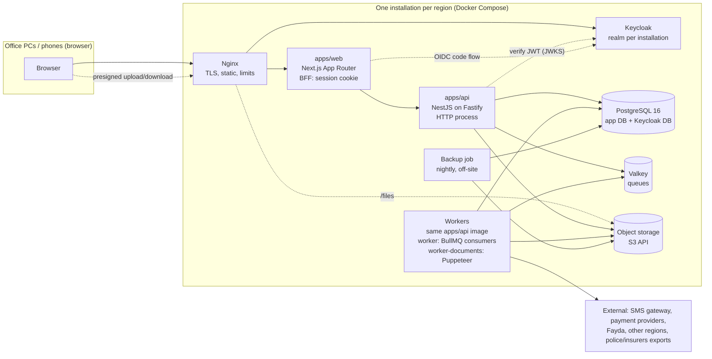

# ITRMS architecture

ITRMS (Integrated Transport and Road Management System, የተቀናጀ የትራንስፖርትና የመንገድ ልማት አስተዳደር ሥርዓት) digitises the
paper work of transport and road development bureaus, zones and woredas. This document describes the target design. The
fixed decisions behind it are in [`decisions/`](decisions/README.md), the starting point is in [`audit.md`](audit.md), and
the build order is in [`phases/`](phases/phase-0.md).

## 1. Shape of the system



- **apps/web**: Next.js App Router with the design system (`packages/ui`) and the form engine (`packages/form-engine`). It acts as a
  backend-for-frontend. The OIDC code flow with PKCE runs on the server, the browser holds only an opaque session cookie while
  tokens live encrypted in a Valkey session store (ADR-0021), and
  `/api/*` calls are forwarded to the API with the bearer token. No token ever reaches browser JavaScript.
- **apps/api**: one NestJS application (Fastify adapter), started in two modes. `main.ts` serves HTTP. `worker.ts` runs
  BullMQ consumers (notifications, reports, SLA timers, outbox relay, imports). `worker-documents.ts` consumes only the documents queue and is the one process that starts Chrome (§10). CPU-heavy or slow
  work never runs inside an HTTP request.
- **One modular monolith, one module per work process** (§3). Modules talk through exported services and domain events,
  never through each other's tables.
- **Keycloak** owns identity, passwords, 2FA, sessions and the group (org unit) and role membership. ITRMS owns the org tree
  itself and mirrors it into Keycloak groups.
- **Object storage** is used only through the S3 API, so the server behind it can change (see ADR-0007).

## 2. Repository layout

```
apps/
  web/                    Next.js (App Router) composition root: shell, generated route files, BFF route handlers
  api/                    NestJS composition root: main, worker, worker-documents, migrate; the migration history
  verify/                 public verification page + verifier PWA (static export)
platform/
  <key>/                  slice packages: kernel, services, forms, workflow, fees, documents, reports, integrations
modules/
  <key>/                  slice packages: registries and work processes (manifest, contracts, api, web, messages, seed, test)
packages/
  schemas/                shared primitives: I18nText, Money, ids, dates, problem+json, error codes, form definition contract
  form-engine/            core (model, conditions, validation, formulas: UI-free, runs in the API too), renderer, designer, viewer
  ui/                     design system: shadcn/ui on Radix + Tailwind 4, composite controls, Ethiopian DatePicker
  ethiopian-calendar/     pure TS: Gregorian ↔ Ethiopian, formatting (am/en/om/ti/wal-Latn), fiscal year, Ethiopian clock
  module-sdk/             defineModule, manifest schema, slot types
  api-client/             openapi.json, generated types, typed fetch client
  testing/                factories, fixed clock, Testcontainers, isolation-matrix generator
  config/                 shared tsconfig, eslint, prettier, vitest presets
infra/
  compose/                docker-compose.yml (dev), compose.prod.yml, nginx/, keycloak/ (realm export, theme)
  backup/                 backup and restore scripts, restore-drill runbook
docs/                     this documentation (architecture, audit, phases, decisions)
```

The inside of every app, slice and package, file naming, and "where does this go" are in
[platform/code-structure.md](platform/code-structure.md) (ADR-0032).

Dependency rules (dependency-cruiser + package `exports`):
- `packages/ethiopian-calendar` and `packages/schemas` depend on nothing internal. `packages/form-engine/core` depends only on
  them and Zod. `packages/ui` depends on `ethiopian-calendar` and `schemas`. The UI parts of `packages/form-engine` depend on `ui`.
- `apps/api` and every slice's `api/` may import `schemas`, `form-engine/core` and `ethiopian-calendar`, **never** `ui` or the
  `form-engine` UI entry points.
- Layers are folders: `packages` → `platform` (kernel, then services) → registries → work-process modules. Only downward
  imports, through package exports. Sideways needs between work-process modules use events or a registry
  (`docs/platform/modularization.md`).

## 3. Backend modules

Registries (master data, one owner each): `parties`, `vehicles`, `drivers`, `associations`, `road-assets`.
Work-process modules (`modules/<key>`):

| Module | Work process | Typical services (of the 54) |
|---|---|---|
| `competency` | 1. Driver & vehicle competency | vehicle registration and plates, bolo inspection, licence issue/renewal/international, transfers, replacements, exams, training-school oversight, licence print batches |
| `public-transport` | 2. Public transport | terminals (menahariya), routes, taxi associations (mahber) and renewals, tariffs, monthly schedules |
| `freight` | 3. Freight transport competency | vehicle competency certificates and renewals, freight association renewals |
| `road-safety` | 4. Road traffic safety | campaigns, safety clubs, zebra crossings, inspections, fines, accidents |
| `road-quality` | 5. Road quality & safety audit | rural access road works, construction supervision |
| `design-contracts` | 6. Design & contract administration | designs, contracts, unit rates, DC3 upgrades, bridge and advance payment documents |
| `community` | 7. Community participation | community maintenance valued in Birr, capital budget allocation |
| `logistics` | 8. Logistics | machinery rental, job creation, tree planting |
| `hr` | 9. HR management | staff, positions (Form 15), leave, benefits, retirement, reports; **the office's monthly payroll list** prepared, approved and sent to Finance (Finance pays and does its accounting; ADR-0016) |
| `planning` | 10. Development plan & budget | annual budget, procurement plan, quarterly reports, capital project progress |

Kernel (`platform/kernel`, one subpath export each): `config`, `errors`, `context` (AsyncLocalStorage request context),
`iam` (JWT verification, guards, **role assignments per unit**), `org` (org tree, levels), `db` (Drizzle, scoped
transactions, RLS helpers), `audit`, `numbering`, `idempotency`, `outbox`, `jobs`, `files`, `notifications`, `i18n`
(tenant language settings, catalogue overrides), `search`.

Platform services (`platform/<key>`, one slice package each): `services` (catalogue, versions, overrides), `forms`
(definitions, versions, submissions, query compiler, saved views), `workflow`, `fees` (fee rules, payment orders,
payments, receipts), `documents` (templates, PDF, verification), `reports`, `integrations` (one port + fake + adapter per
external system).

## 4. Request lifecycle

1. Nginx → web (BFF) → `POST /api/...` with `Authorization: Bearer <access token>`, `Idempotency-Key` on commands, and
   `X-Org-Unit` (the active unit, when the user belongs to several).
2. `AuthGuard` (global, default deny): verifies the JWT against Keycloak's JWKS (`jose`) and resolves the user. Their
   **roles for the active unit** come from ITRMS's own `role_assignments` (user × unit × role, with validity dates), not from
   token claims; they are cached per user and invalidated on change. `X-Org-Unit` must be a unit the user holds an active
   assignment in.
3. `PermissionGuard`: `@Require('licence:issue')` metadata on each handler. A route without it is refused at startup
   (a test enumerates routes).
4. Validation pipe: the Zod schema from the slice's `contracts` (primitives from `packages/schemas`; no class-validator).
5. Service method runs inside `db.scoped(ctx, tx => …)`. This opens a transaction and sets the RLS settings with
   `set_config(..., true)` (§5). Every query in the request goes through `tx`.
6. Writes go through repository helpers that write the **audit row in the same transaction** and append **outbox events**
   for side effects (SMS, PDF, SLA timer).
7. Commit. The outbox relay (worker) enqueues the jobs, and workers do the slow or external work idempotently.
8. Errors become RFC 9457 `application/problem+json` (`type`, `title`, `status`, `code`, `detail`, `errors[]`, `traceId`).
   The `title` is an i18n key resolved in the user's language.

## 5. Tenancy and row-level security

### Org-unit tree
- `org_level_definitions(region_id, depth, key, name I18nText)`: configurable depth and level names per region. The default
  is `region > zone > woreda`. Some regions have no zones. Special woredas sit directly under the region. City
  administrations have sub-cities. Woredas carry a category (ምድብ) and towns a grade (ፈርጅ 1–4), as on the Form 15 cover pages. Graded towns are org units of kind
  `town_admin`.
- `org_units(id, region_id, parent_id, path ltree, kind, level_key, code, name I18nText, category, keycloak_group_id,
  active, …)`. `category` holds the woreda category or town grade from the regional structure (e.g. "ምድብ 1 ወረዳ", level-3
  town), which staffing and fees may depend on.
  `path` is the materialised ancestry (`r_9f3.z_12a.w_7c1`) maintained by triggers. Moves are rare, admin-only, and audited.
  ltree is a contrib extension under the PostgreSQL licence.
- Directorates inside a unit (the work processes) are **not** tenancy levels. They are `org_departments` used for task
  routing and HR positions.

### What a user may see
A user acts in one **active unit** at a time. Their **scope** is that unit's subtree. Four table classes get four policy
shapes (applied by `kernel.apply_rls(table, class, column)` in migrations, always `TO itrms_app`; the scope column is
kept by the `kernel.set_org_path` trigger from the row's unit, and rewritten when a unit moves):

| Class | Examples | Read | Write |
|---|---|---|---|
| **R: regional registry** | persons (non-sensitive part), organisations, vehicles, plates, licences, associations, routes, terminals, road projects, contracts | whole region | `WITH CHECK`: the record's `handling_org_path` is inside the actor's scope (a unit may change only records it handles); regional creation through registry commands |
| **T: local transaction** | cases, submissions, inspections, exams, payments, receipts, fines, accidents, issued documents, tasks, **medical certificates**, **audit_log** | region matches **and** `org_path <@ scope` | same |
| **C: configuration** (inherited down the tree) | service overrides, fee overrides, document headers, unit settings, unit types | own subtree **and** ancestors | own subtree, with an admin role |
| **P: party-scoped** (external participants, Phase 1) | a training school's readiness lists, an association's schedules | rows whose applicant/organisation = `app.party_id` | same |

```sql
-- class T policy (sketch). No bypass branch: system work uses a separate role (below).
CREATE POLICY t_scope ON workflow.cases TO itrms_app USING (
  region_id = (SELECT nullif(current_setting('app.region_id', true), '')::uuid)
  AND org_path <@ (SELECT nullif(current_setting('app.scope_path', true), '')::ltree)
) WITH CHECK ( /* same */ );
```

- **Fail closed.** A pooled connection that once ran a scoped transaction returns `''` (not NULL) for the setting
  afterwards, and `''::ltree` is the ancestor of every path. `nullif(…, '')` turns a missing context into NULL, so nothing
  matches. Every class also checks `region_id`. The `(SELECT …)` wrapper evaluates the setting once per query (an initplan).
  The isolation matrix runs its "no context" case **on a connection that has already served a scoped transaction**.
- **No bypass flag.** Custom settings such as `app.*` can be set by any session, so a policy must never trust one to
  disable itself. System work (outbox relay, SLA sweep, data migrations, cross-unit history) runs on a **separate pool as
  role `itrms_system` (BYPASSRLS)**, only inside the worker, and every use is logged.
- **DB roles:**
  - `itrms_owner` owns the tables and runs migrations. FORCE RLS is *not* set, so the owner's migrations see all rows.
  - `itrms_app`, the API, is subject to all policies.
  - `itrms_system` (BYPASSRLS) is used only by the worker's system pool.
  - `itrms_backup` is used by pgBackRest (replication and backup privileges only).
  - Keycloak has its own database and role.

  `SECURITY DEFINER` functions are owned by a dedicated non-login role with BYPASSRLS. Each applies explicit region and
  scope predicates and sets `search_path = pg_catalog, <schema>`.
- **Sensitive personal data is not in class-R rows.** Fayda FIN, phone, birth date, photo, bank account and medical
  results live in separate tables (`person_sensitive`, …). They are envelope-encrypted per field (§18), with an HMAC
  **blind index** for exact-match search and duplicate detection. They are read only through an audited `reveal()` path
  that checks `pii:reveal` and a reason. Roles without it (e.g. `viewer`, `auditor`) see masked values everywhere, including
  exports and audit diffs.
- **Search under RLS.** pg_trgm and JSONB operators aren't leakproof, so the planner can't use their indexes ahead of an
  RLS filter. Name search, lookups and registry history therefore go through `STABLE SECURITY DEFINER` search functions.
  These apply the region and scope predicates themselves, use the trigram and blind indexes, and return ids that the caller
  then reads under RLS. EXPLAIN under RLS is a "done when" of every search task.
- Every class-T row carries `handling_unit_id` **and** a denormalised `org_path` (set by trigger from `org_units`, indexed
  with GiST). The policy therefore needs no join.
- **Registries are regional, transactions are local.** A vehicle row exists once per region. Its `handling_unit_id` says
  which office currently handles it. A transfer between zones is two linked cases, *transfer-out* (handled by the source)
  and *transfer-in* (handled by the destination). Completing the transfer-in changes `handling_unit_id` through an audited `SECURITY DEFINER`
  registry command that checks the completed transfer-out case and the actor's scope, in the effect's transaction (the
  system role never runs in a request; code-structure.md §3). The record is never copied.
- History across units: the registry page shows a record's full timeline through one search function that returns only
  non-sensitive columns (service, date, handling unit, outcome) for the region. Full case details stay scope-limited.
  This is the proposed default, to be confirmed (business question B8).
- **Isolation is enforced twice:** NestJS guards check scope before touching data (clear 403/404), and RLS guarantees it even
  when a query is wrong. The isolation test matrix (task 0.9) runs every repository read and write as users of own, child,
  parent, sibling, other-zone and other-region units, plus the no-context case on a reused connection, for each table class.

### Keycloak mapping
- One realm per installation. **Keycloak does authentication only:** passwords, 2FA, sessions, brute-force detection.
  The org tree is mirrored as Keycloak groups for administration convenience, but **authorization comes from ITRMS's
  `role_assignments`** (user × unit × role, valid from/to, granted by, reason). One person can be cashier at Boditi and
  records officer at the zone, and revoking a role takes effect at once (the cache is invalidated). The same table supports
  delegation and substitutes (time-boxed assignments) and access reviews.
- ITRMS is the source of truth for the tree and the assignments. Creating or renaming a unit calls the Keycloak Admin API
  (adapter, via the outbox).
- 2FA is required for staff: TOTP (an authenticator app, or **hardware TOTP tokens** for staff without smartphones or on
  shared PCs), with passkeys/WebAuthn offered. No SMS OTP.
- Service accounts (other government systems, Phase 1+) are Keycloak clients bound to **one unit and an explicit
  permission subset**. External participants (training schools, association representatives) use a separate Keycloak
  client and class-P scope.

## 6. Data model outline

Conventions: UUID v7 primary keys; `region_id` on every tenant table; class-T tables add `handling_unit_id` + `org_path`;
`created_at/by`, `updated_at/by`, `row_version` (optimistic locking); soft delete only where the business needs it (registry
records are **deactivated**, never deleted); `timestamptz` stored in UTC, business dates as `date` computed in
`Africa/Addis_Ababa`; money as `bigint` santim (`*_santim`) or `numeric(18,4)` for quantities and unit rates; names as
`I18nText` JSONB (`{"am": "…", "en": "…"}`) where the bureau names things, and as separate script columns for people (§6.1).

### 6.1 Core (typed) tables
| Group | Tables |
|---|---|
| Org and access | `org_level_definitions`, `org_units`, `org_departments`, `unit_types` (+ services, roles, capabilities), `unit_service_overrides`, `users` (Keycloak `sub`, display name, active unit), **`role_assignments`** (user, unit, role, valid from/to, granted by, confirmed by, reason), `role_grant_requests` (a grant waiting for a second administrator, SEC-AC-6, task 0.21e) |
| Parties | `persons` (given/father/grandfather name in Ethiopic **and** Latin script, sex, birth year, address down to kebele: the non-sensitive part, class R), `person_sensitive` (Fayda FIN, full birth date, phone, photo file: field-encrypted, blind-indexed, revealed through `reveal()`), `organisations` (kind: association, training school, contractor, consultant, garage, insurer, health facility, government office; TIN, licence no, address), `organisation_members` |
| Vehicles and plates | `vehicles` (**federal vehicle id** from the national system (Directive 1050/2025), chassis/VIN, engine no, make, model, year, category, use, seats, load capacity, colour, fuel, owner party, handling unit, status), `vehicle_ownerships` (history), `plates` (format national `ETH ABC 1234` or legacy regional code + number; source federal/legacy; status in_stock/allocated/assigned/lost/returned/retired; allocated unit), `plate_assignments`, `libres` (title document issues), `inspections` (bolo: checklist JSONB from the form, result, inspector, garage, valid_until, bolo number) |
| Drivers | `driver_licences` (number, person, status, issuing unit, issue/expiry dates), `licence_grades` (grade/category per licence with dates), `medical_certificates` (class T: case evidence, sensitive), `exam_sessions`, `exam_results` (theory/field, attempt), `training_enrolments` (school, trainee, completion), `licence_print_batches` (sent to region, returned, distributed) |
| Associations and public transport | `associations` (mahber; kind taxi/bus/freight; licence no; renewal due), `association_vehicles`, `terminals` (menahariya), `routes` (from/to, distance, kind), `tariffs` (versioned, approved), `monthly_schedules` (+ lines) |
| Road safety | `campaigns`, `safety_clubs`, `crossings`, `traffic_inspections`, `fines` (offence code, amount, driver/vehicle, ticket no, payment), `accidents` (place, time, vehicles, persons, injuries by severity, damage in santim, shared-with log) |
| Roads and contracts | `road_projects` (kind, length, location, status, woreda), `designs`, `contracts` (contractor/consultant party, amount, dates, status), `unit_rates` (versioned catalogue from the region), `boq_items`, `payment_certificates` (+ lines, advance, retention), `quality_audits`, `supervision_visits`, `community_works` (valued in santim), `capital_allocations` |
| Logistics | `machinery`, `machinery_rentals` (contract, rates, hours), `job_records`, `tree_planting_records` |
| HR and payroll list | `staff` (person, position, grade, step, unit, employment dates, bank account for Finance), `positions` (Form 15: title, job code, grade, unit, count), `leave_requests`, `leave_balances`, `benefit_records`, `retirements`; payroll list: `salary_scales` (grade × step → santim, versioned with effective date), `pay_components` (allowances and deductions: kind, taxable, pensionable, formula), `tax_tables` and `pension_rates` (versioned), `payroll_periods` (Ethiopian month, state draft/approved/sent/locked), `payroll_lines` (per staff: basic, allowances, attendance/leave deductions, tax, pension, other deductions, net; computed and frozen at approval), `payroll_adjustments` (arrears, corrections carried to a later month) |
| Planning | `budgets` (+ lines, per Ethiopian fiscal year), `procurement_plans` (+ lines), `performance_reports` (quarterly), `project_progress` |
| Money | `fee_rules` (versioned), `payment_orders` (+ lines), `payments`, `receipts`, `receipt_reversals`, `cashier_sessions` (daily closing), **`external_payment_refs`** (issuer, reference, fiscal year, amount, status pending_verification/verified/rejected; unique per issuer + reference + year), `controlled_stock` (serial ranges of licence card blanks, bolo stickers, receipt pads: issued to unit, used, spoiled, reconciled) |
| Documents and files | `document_templates` (versioned), `issued_documents` (number, type, subject, case, verification token hash, file, status), `files` (object key, sha256, type, size, scan status) |

### 6.2 Service, form and case tables (configuration + JSONB answers)
| Table | Purpose |
|---|---|
| `service_definitions` | the catalogue (54 rows at the start): code (e.g. `DVC-LIC-NEW`), work process, name `I18nText`, subject kind (person, vehicle, association, project, none), module key |
| `service_versions` | a bureau default: form version, workflow definition version, fee rule version, document template versions, override policy (which keys a lower unit may change), effective dates |
| `service_overrides` | per org unit: a patch of allowed keys (enabled, SLA hours, extra form overlay, help texts, template header); class C |
| `form_definitions`, `form_versions` | the engine's documents (content-hashed, immutable versions; `I18nText` labels) |
| `form_publications` | a request to make a form version the published one, decided by a second person (SEC-AC-6); class T at the form's owner unit |
| `cases` | one service request: number, service version, resolved-config hash, applicant party, **subject refs** (`vehicle_id`, `person_id`, `licence_id`, `association_id`, `project_id`; typed FKs, nullable), handling unit, state, timestamps; class T |
| `submission_revisions` | the answers a case's request held before each change through its workflow (task 0.21e): append-only, class T at the handling unit. A change (an action with `amendsRequest`) is a **patch**: the answers the actor changed, of fields they may see and change, settled and checked on the version it was filed on; every other answer stays as filed (other roles' fields, Sensitive answers, what the actor's own rules hide or close, a repeating section holding answers they may not see), and a field derived from the answers alone is computed again. A field the actor sees but may not change is refused by name |
| `submissions` | form answers: `case_id`, `form_version_id`, `step_key`, `answers JSONB`, `submitted_by`; answers hold **ids** of registry records picked by lookup fields, never copies |
| `workflow_definitions` | versioned JSON (§8) |
| `case_tasks` | open and closed human steps: role, unit, due_at, claimed_by, outcome; class T on the assignee unit (a step in a unit above the actor's scope is opened through the reviewed `workflow.open_task`, task 0.19b) |
| `case_events` | append-only timeline (transitions, routings, comments, payments, documents); class T at the handling unit |

The JSONB answers are the evidence of what was filled in. **The registry tables are the truth.** Workflow effects copy the
facts that matter (licence grade, issue date, plate number) from answers into typed tables, in the same transaction, so
reports and lookups never parse JSONB.

### 6.3 Platform tables
`audit_log` (append-only, hash-chained, class T, monthly partitions), `number_counters`, `idempotency_keys`,
`outbox_events`, `notifications`, `settings_values`, `translation_overrides`, `saved_views`, `working_calendars` (working
days and hours per region/unit, lunch break, half days) + `holidays`, `correspondence` (numbered incoming/outgoing letters,
ደብዳቤ), `appeals` (a sub-case linked to any decided case; 30-day window under Proclamation 1074/2018 Art. 24).

## 7. Service configuration

A service is **configuration**: form definition + workflow + fee rule + document templates. The bureau publishes a default
`service_version`. A lower unit may override only the keys the version's `overridePolicy` allows. **One resolver** walks the
unit's actual ancestors (the ltree path, whatever the levels are called or however deep they go), then the unit's **unit
type**, then the unit itself; the nearest value wins per key:

```
effective(service, unit) = default(service_version) ⊕ override(ancestor_1) ⊕ … ⊕ override(ancestor_n) ⊕ unit_type ⊕ override(unit)   (allowed keys only)
```

- The **same resolver** serves the settings registry ([platform/org-and-unit-types.md](platform/org-and-unit-types.md)
  §4). Service keys (`approval_unit`, SLAs, form overlays, help texts) live **only** in service overrides; the settings
  registry references them and never stores them twice.
- Form overrides are **overlays** (add fields after an anchor, change help texts or options within the allowed set). They
  are not forks: when the bureau publishes a new form version, the overlays are re-applied and checked at publish time.
- When a case is created, the effective configuration is resolved and **frozen** on the case (`resolved_config_hash` + the
  version ids). Later configuration changes never alter open cases.
- Coded behaviour stays in modules: a service version names its effects (e.g. `competency.issueLicence`), and only effects a
  module registered can be named (checked on publish).
- Built in task 0.21b ([platform/services/README.md](../platform/services/README.md)): the keys are families (`sla.<state>`,
  `approval_unit`, `help.<field>`, `templateHeader`); the policy names, per family, the levels (`region`, `unit`) that may
  change it; a unit-type layer for services is not used yet (service enablement per unit type is `unit_type_services`).
  A new version reports the overrides below it that no longer fit (a state or field it lacks, a family it no longer
  allows); they stay stored and are passed over. The frozen configuration is the case's `config` (with `config_hash`);
  the engine reads a step's SLA from it before the workflow's. Form overlays follow in 0.21d.

## 8. Workflow engine

Definition (Zod schema `workflowDefinitionSchema` in `packages/schemas`; stored as immutable, content-hashed versions of a
`workflow_definitions` row, which holds the key and the name; task 0.19a):

```jsonc
{
  "schemaVersion": 1,
  "states": [
    { "key": "draft", "kind": "start" },
    { "key": "review", "kind": "task", "label": {"am": "ሰነድ ማጣራት", "en": "Document review"},
      "assignee": { "role": "competency.officer", "unit": "handling" }, "sla": { "businessHours": 8 } },
    { "key": "exam", "kind": "task", "assignee": { "role": "competency.examiner", "unit": "handling" },
      "stepForm": "exam-result@2", "sla": { "businessDays": 10 } },
    { "key": "payment", "kind": "task", "assignee": { "role": "cashier", "unit": "handling" } },
    { "key": "approval", "kind": "task", "assignee": { "role": "competency.lead", "unit": "${approval_unit}" }, "separationOfDuties": ["review", "exam"] },
    { "key": "national", "kind": "wait", "label": {"am": "ብሔራዊ ማረጋገጫ በመጠበቅ ላይ", "en": "Waiting for the national platform"},
      "sla": { "businessDays": 2 } },
    { "key": "issued", "kind": "end" }, { "key": "rejected", "kind": "end" }
  ],
  "transitions": [
    { "from": "draft", "to": "review", "action": "submit" },
    { "from": "review", "to": "exam", "action": "approve" },
    { "from": "review", "to": "draft", "action": "return", "commentRequired": true },
    { "from": "exam", "to": "payment", "action": "pass", "effects": ["fees.createPaymentOrder"] },
    { "from": "payment", "to": "approval", "action": "paid", "guard": { "fact": "payment.settled", "op": "eq", "value": true } },
    { "from": "approval", "to": "national", "action": "approve",
      "effects": ["competency.createPendingLicence", "integrations.national.requestLicence"] },
    { "from": "national", "to": "issued", "on": "event:national.licence.accepted", "actor": "system:national-driver-platform",
      "effects": ["competency.activateLicence", "documents.issue:licence-card", "competency.addToPrintBatch"] },
    { "from": "national", "to": "approval", "on": "event:national.licence.rejected", "actor": "system:national-driver-platform",
      "effects": ["competency.voidPendingLicence"] },
    { "from": "national", "to": "approval", "on": "timeout", "effects": ["notifications.escalate"] },
    { "from": ["review", "exam", "payment", "approval"], "to": "rejected", "action": "reject",
      "rejectRoles": ["competency.officer", "competency.lead"], "commentRequired": true }
  ]
}
```

- **Runtime:** `POST /cases/:id/transitions { action, answers?, comment? }` checks, in one transaction: the actor holds the
  step's role in the task's unit; separation of duties (the maker cannot approve); the guard; the step form (server-side
  validation with `packages/form-engine/core`). It then runs the **effects** (registered code, in the same transaction), writes
  `case_events`, closes and opens `case_tasks`, writes audit rows and outbox events. A failing effect rolls everything back.
- **State kinds:** `start`, `task` (a human with a role acts), **`wait`** (the case waits for an event: a national-platform
  answer, a payment webhook, a scan result, a timeout), `end`. Event-driven transitions are performed by audited **system
  actors** (`system:<adapter>`), never by a pretend user. `reject` is allowed only from listed states, by `rejectRoles`.
- **Nothing competes with a national record.** A licence is created as `pending_national`. The certificate, QR and print
  batch follow only after the national platform accepts it. A rejection voids the pending record (with history), and the case
  returns for correction.
- **Assignment:** `unit` is `handling`, `parent` (e.g. the zone approves for a town), `region`, or a named level. Where the
  service allows it, it comes from the override key `approval_unit`. A task is visible to every holder of the role in that
  unit (from `role_assignments`), and one of them claims it.
- **Small offices:** if separation of duties leaves no eligible actor in the unit, the task is **routed to the parent
  unit** automatically. This is recorded on the case and in the audit, so it never deadlocks and never silently relaxes the
  rule.
- **SLA (task 0.20a):** `due_at` is computed by one helper in the application (`businessDeadline` in
  `@itrms/ethiopian-calendar`, never in SQL), with the unit's **working calendar**
  (working days and hours, lunch break, half days, holidays) in Addis Ababa time. A BullMQ delayed job fires at
  `due_at` (marks the task overdue, notifies, escalates one level up). A 15-minute sweep catches lost timers. Escalation never
  changes who may decide. It adds visibility for the supervisor. The timer is an outbox event available at `due_at` (`case-task.due.v1`,
  `case.wait-due.v1`); a step's supervisors are its office's `unit_head`s, the escalation tells the office above; a wait
  past its SLA leaves by its `timeout` transition (`system:timer`). The national holidays are computed (fixed dates and
  the Orthodox Easter); the Muslim ones are provisional data a region confirms in `workflow.holidays`. Notifications are
  `kernel.notifications`, read by their recipient only through reviewed functions.
- **Inbox and comments (task 0.20b):** a person's inbox is the open steps of their active unit for the roles they hold
  there, by due time; one of the role's holders takes a step on (`claimed_by`) and the others may not act on it until it
  is given back. A comment is a `comment` event on the timeline (internal); the people it mentions must work on the case
  (an active role in its handling office or above it: the reviewed `workflow.case_people`), and the worker tells them.
- **Versioning:** a case runs on the definition version it started with. Storing a version runs the engine's checks
  (`platform/workflow/api/engine/check.ts`): one start; every state reachable; an end reachable from every state; a task
  left only by actions, a wait only by events or its timeout (with an SLA), an end never; separation of duties naming
  steps people act on; and the roles, effects (the kernel's effect registry, `@itrms/kernel/effects`) and step forms
  (`<form-key>@<version>`) the installation knows. Problems come back in the reader's language.
- **Guards** are a small language over the case's facts (`eq`, `ne`, `in`, `gt`, `gte`, `lt`, `lte`, `exists`, combined
  with `all`, `any`, `not`, at most 6 deep); no regular expressions. The engine's rules (`engine/rules.ts`) are pure
  functions: the transition runner (0.19b) gathers the facts and asks them.
- Legacy "status" fields do not exist. A case's state changes only through transitions (closes legacy gap #2).

## 9. Fees, payments, receipts

- **Fee rules** are versioned JSON evaluated on the server with the shared formula evaluator (`packages/form-engine/core`, integer
  santim arithmetic, explicit rounding). Components are a base fee by category or grade, a late penalty per started month, a
  replacement fee, and so on. Inputs are case facts (vehicle category, licence grade, months since expiry). The form's `Fee`
  field shows a preview, and the server's figure is authoritative.
- A workflow effect creates a **payment order** (lines, total, due date). There are three ways to settle it:
  1. **At the office cashier:** cash or a bank deposit slip. A **receipt** is issued with a gapless number and a QR code.
  2. **Paid elsewhere** (revenue office, bank): the officer enters the external reference. It is stored in
     `external_payment_refs`, which is **unique per issuer, reference and fiscal year**, so one real receipt can never settle
     two cases. Its state is `pending_verification` until a `finance_officer` (not the officer who entered it) verifies it,
     or until it matches an **imported daily statement** from the revenue office or bank. Only a verified reference
     satisfies `payment.settled`.
  3. **Online** (Phase 3): a provider webhook moves the case out of a `wait` state after signature check and idempotent
     settlement.
- Corrections are reversals with a reason and a second person's approval, never edits.
- **Daily cashier closing:** expected vs. counted cash, unmatched external references, and **controlled stationery**
  (receipt pads, licence blanks, bolo stickers) reconciled by serial range. Remittance report to the revenue office
  (Phase 1).
- Online payments (any NBE-licensed provider, MoF Directive 1069/2025; Phase 3) go through one `PaymentProvider` adapter
  interface with webhooks, signature checks, idempotent settlement and a daily reconciliation job.

## 10. Documents and verification

- `document_templates`: versioned **LiquidJS** HTML templates with i18n strings, paper size and the Zod schema of the data
  they need. **`outputEscape: 'escape'` is on**, so applicant data can never inject markup. Region and unit headers (name,
  logo, stamp image) are class-C settings.
- Rendering runs in a **separate `worker-documents` service** (same image, documents queue only, its own memory limit), so a
  Chrome spike never stalls the outbox, SLA timers or notifications. Puppeteer runs with **JavaScript disabled**, all
  network blocked (request interception, inlined assets only) and a `default-src 'none'` CSP in the template wrapper.
  Fonts (Noto Sans Ethiopic, Noto Sans) are bundled; Ethiopian dates come from `packages/ethiopian-calendar`. The PDF goes to
  object storage.
- **Verification works offline and online.**
  - The QR carries a compact **Ed25519-signed payload**: type, number, validity dates, issuing unit, and a hash of the
    holder's name and photo. The **verifier PWA** (a phone app for police, insurers, other offices) checks the signature
    with no network, against the region's published public key.
  - Online, the same QR opens `https://verify.<region-domain>/<token>`, which also shows **revocation and superseded
    status**. Tokens are random 128-bit values, and only their hash is stored.
  - The verification site is a **separate public host** (§17), shows only what a checker needs (masked name), is
    rate-limited, and needs no sign-in.
- Reprints reuse the stored PDF. A correction supersedes the old document, and the old QR then reports "superseded".
- The signing keys (QR payload; later PAdES signatures under Proclamation 1072/2018) are per region, rotated yearly. Their
  public keys are published, and old keys stay valid for verifying the documents they signed.

## 11. Forms in ITRMS

- The engine (`packages/form-engine`) keeps the existing design: a flat field list with `parentId`, the kit of 25 types, conditions,
  `FormArray`, safe formulas, data sources, versioned publishing. ITRMS adds `I18nText` labels, `EthDate`, `RegistryLookup`,
  `Fee`, `requiredWhen`/`validWhen`, and a print mode (audit §11).
- **The same validation runs in the browser and in the API** (`validateForm` from `packages/form-engine/core`). The API prunes the
  values of hidden fields, checks `RegistryLookup` ids exist in the user's region, and stores the answers with the form
  version.
- Forms capture. Code acts. A form never carries code. Effects that touch registries or money are module code named by the
  service version.
- The data viewer (table, board, calendar, pivot, dashboard; saved views; CSV and Excel export) works for every service's
  cases through the ported query compiler, with RLS applied. **Scale rules:**
  - every query carries a service or form filter;
  - fields the form author marks **filterable** are indexed in the typed value table `forms.submission_values`, written
    with each submission and filled for existing ones when a version makes a field filterable (ADR-0035; no runtime DDL);
  - each request has a `statement_timeout`;
  - large results become asynchronous exports.
- **Reports** read typed tables, plus the `reports` module's own views. Raw JSONB is queried only by the data viewer, for
  service-specific operational lists.

## 12. Background jobs

BullMQ on Valkey. Queues: `outbox` (relay), `notifications` (SMS, in-app, email), `documents` (PDF, its own worker
service), `reports` (heavy exports and quarterly reports), `sla`, `imports` (paper-record migration), `integrations`.
- **Transactional outbox:** events are written in the business transaction with state `pending`. The relay (system role)
  reads them with `FOR UPDATE SKIP LOCKED`, enqueues them with `jobId = event id`, and marks them `enqueued`. The handler
  marks the event `done` when it succeeds. A sweep re-enqueues events left `enqueued` too long. So losing Valkey loses no
  work.
- Every handler is idempotent, retries with exponential backoff, and parks failures in a dead-letter list visible to admins.
- The relay and the sweeps poll every second or minute on the system pool. Each such recurring reason is written to the
  audit log at its first use in a process and logged at every use, so the log records that the relay ran without a row per
  poll.
- **Valkey configuration:** `appendonly yes`, `appendfsync everysec`, `maxmemory-policy noeviction`. There are separate
  instances for queues and for BFF sessions, each with its own memory alert.
- Scheduled jobs (BullMQ repeatable jobs): SLA sweep, licence and association renewal reminders (SMS N days before expiry),
  nightly report snapshots, daily audit digest (§15), daily signed backup report.

## 13. Language and calendar

- Per-tenant language list (default `am`, `en`; the first tenant adds Wolaytta as `wal-Latn`, see
  [`i18n-and-languages.md`](i18n-and-languages.md); `om`, `ti` and others per region). UI strings use
  `next-intl` message catalogues owned by each slice (`<slice>/messages/<lang>.json`; shell strings in `apps/web/messages`),
  merged at build, keys required in `am` and `en` (CI check; optional languages reported). Data
  names use `I18nText`, falling back to the tenant's default language.
- Dates are stored Gregorian (`date`, `timestamptz` UTC). They are displayed and entered in the **Ethiopian calendar** by
  default (Gregorian toggle per user), and printed Ethiopian with the Gregorian date in brackets where the bureau requires.
  The timezone is always `Africa/Addis_Ababa` (UTC+3, no DST). The Ethiopian fiscal year (Hamle 1 – Sene 30) drives budgets,
  reports and yearly counter resets.
- `packages/ethiopian-calendar`: conversion through the Julian Day Number, leap years (Pagume 6), month names per language,
  Ethiopic numerals optional, the Ethiopian 12-hour clock optional. Tested against a reference table and property tests
  (round trip over 1900–2100).

## 14. Files

Object storage through the S3 API (SeaweedFS, ADR-0020).
- **Uploads:**
  - Small files use a **presigned POST** with a `content-length-range` condition and a content-type condition.
  - Large files use multipart (Uppy): the server issues part URLs only up to the size the client declared (and a maximum
    part count), and a per-user quota applies.
  - Objects land under `quarantine/`. The API then confirms the upload (size, sha256, magic bytes). Malware scanning
    (ClamAV, from Phase 1, ADR-0022) promotes the object to `clean/`. Until then, files are `pending_scan` and can't be
    downloaded.
  - A lifecycle rule aborts incomplete multipart uploads and deletes unconfirmed objects after 24 h.
- **Downloads:** short-lived presigned GETs after an authorization check.
- **Exposure:** Nginx `/files` passes only signed object-level GET, PUT and POST requests. Bucket listing and every
  bucket-level operation are denied, and the S3 endpoint is otherwise internal.
- **Layout:** one bucket per installation, keys `clean|quarantine/<region>/<yyyy>/<uuid>`.

## 15. Audit, numbering, idempotency

- **Audit:** every insert, update or delete of a business table writes `audit_log(actor, unit, org_path, action, table, row
  id, diff, request id, ip, at, prev_hash, hash)` in the same transaction.
  - **Masking:** fields classified as personal or sensitive (Fayda FIN, phone, medical results, salary, bank account) are
    stored in the diff only as an **HMAC** (proving a change, not revealing the value). Secrets are never stored.
  - **Tamper evidence:** the table is append-only (trigger, and no UPDATE/DELETE grant) and class T (people see the audit of
    their own scope). Rows are **hash-chained** per partition. A **signed daily digest** of the chain head goes to the
    off-site backup, so any later alteration is detectable.
  - **Sensitive events** (reveals, exports, denials, sign-ins) are written in their **own short transaction** (rate-limited),
    so a rolled-back request still leaves its denial on record.
  - Monthly partitions keep the table fast. Old partitions are archived, never deleted, before their retention ends.
  - **Subject access:** a "who accessed my data" report per person (PDP 1321/2024).
- **Numbering:** counters are only for documents **ITRMS itself legally issues**: receipts, its own certificates and
  correspondence numbers.
  - Each call is one `UPDATE … SET next_value = next_value + 1 RETURNING` inside the business transaction, so numbers are
    gapless and serialised per counter. Patterns are per region (`{unitCode}/{seq:06}/{efy}`).
  - When records are migrated, each counter is seeded with `start_after` = the highest migrated number.
  - **Plate numbers are the federal serials** (Directive 1050/2025). **Licence numbers become the national reference** once
    the national platform issues them; until then a regional counter is used, configured per region.
  - **Case numbers** use an ordinary PostgreSQL sequence (gaps are harmless there, and it avoids contention).
- **Idempotency:** every POST carries an `Idempotency-Key`. The record is stored as (user, method, route, key,
  request_hash) under a unique constraint, inserted **in the business transaction**.
  - A replay with the same hash returns the first result. A replay with a different hash gets 422.
  - Keys are kept for **7 days**. The PWA queue asks the user before replaying anything older than 6 days (ADR-0024).
  - The record also names the **unit** the request acted for (`X-Org-Unit`, part of the request): the same key sent for
    another unit is another request, and each record lives in its unit's RLS scope.
  - A POST does its work in **one** `db.scoped` transaction, which carries the record (development and tests refuse
    another shape).

## 16. Integration adapters

Each external system is one interface in `platform/integrations/<system>` with a **fake** (default in dev and
tests) and real implementations chosen per installation. Calls run only in workers (via the outbox), with timeouts, retries,
audit, and no secrets in logs.
- **Egress control (SSRF):**
  - Workers reach the outside only through an **allowlisting forward proxy**, and private ranges are denied.
  - The worker network is split from the data network.
  - Integration endpoints and credentials come only from ops configuration (sops), **never from the admin UI**. Inbound
    webhooks are verified by signature.
- **National interoperability:** the versioned API (`/api/v1`) is documented for **MESOB** (the national one-stop service
  platform and its Bridge API gateway) and for other government systems, with service accounts bound to a unit and a
  permission subset.

| Adapter | Direction | Phase |
|---|---|---|
| SMS gateway (Ethio telecom, Safaricom Ethiopia or an aggregator) | out: reminders, OTP (if chosen), case updates | 0 (fake) / 1 (real) |
| **National vehicle registration** (MoTL, Directive 1050/2025) | out: register / transfer / plate exchange; in: federal vehicle id, plate, status. Until an interface exists: manual entry of the federal reference + reconciliation report | 0 (fake) / 1 |
| **National driver platform** (MoTL digital driver registration, training, assessment, certification) | both: licence status, exam results, print requests; ITRMS never overrides the national status | 0 (fake) / 1–2 |
| **National traffic point-based penalty system** (MoTL + Ethio telecom) | in: fines and points for the zone's reports; out: tickets written by zone inspectors (if the system accepts them) | 2 |
| Regional licence printing | out: print batch file; in: printed / returned status (may be replaced by the national platform) | 1 |
| Police and insurers, insurance fund | out: accident and fine data sharing (scheduled export or a pull API with keys) | 2 |
| Finance (monthly payroll list, HR changes), civil service, pension agency | out: signed PDF + Excel/CSV in their formats | 3 |
| Payment providers: any NBE-licensed provider (MoF Directive 1069/2025): an aggregator (e.g. Chapa) + telebirr, CBE Birr | out: payment requests; in: signed webhooks + reconciliation; the full fee is always received | 3 (earlier if the region asks) |
| Fayda national ID (NIDP, MOSIP-based verification) | out: verify identity, fetch demographics with consent | 3 |
| Cross-region transfer (another ITRMS installation) | both: signed transfer packets over mTLS, idempotent, two-phase (offer → accept) | 3 |

National systems change fast (see [`ethiopia-context.md`](ethiopia-context.md)). The rule: **ITRMS is the system of record
only for the zone's own work.** Where a national system is the system of record (federal vehicle id, national licence
status, penalty points), ITRMS stores that system's reference and a read copy, never a competing value.

## 17. Deployment, backup, operations

- **One installation per region:** a Docker Compose project on the region's server: nginx, web, api, worker,
  worker-documents, keycloak, postgres, valkey (queues) + valkey (sessions), SeaweedFS, egress proxy, backup agent.
  - Images are built and signed in CI and pulled to the site, or loaded from a signed tarball where internet is poor.
  - Database migrations run as a one-shot `migrate` service before `api` starts.
  - A **training installation** runs as a separate Compose project on the same host. It has its own database, realm, bucket
    and hostname; SMS and payments are forced to the fakes; its documents verify as "TRAINING – not valid".
- **Public exposure (three hostnames):**
  - `verify.<domain>`: **public**. The verification page and, later, payment webhooks only. Rate-limited, cache-friendly.
  - `app.<domain>`: staff application and Keycloak login. Exposed to the internet only where offices have no WAN/VPN;
    otherwise limited to office networks or WireGuard.
  - Keycloak admin: **internal interface only** (`KC_HOSTNAME_ADMIN`). Nginx blocks `/auth/admin` and
    `/auth/realms/master`, and brute-force detection is on.
  - TLS 1.2+ (the bureau's certificate or ACME), HSTS, a nonce-based CSP, `frame-ancestors 'none'`, and other security
    headers. Rate limits on login, verification and public endpoints.
- **Backups:**
  - **Database:** a pgBackRest **repository host at the second site pulls** the backups, so the main server holds no
    repository credentials and can't delete them. `repo-cipher-type=aes-256-cbc`. Weekly full, nightly differential,
    continuous WAL archive (point-in-time recovery).
  - **Files:** SeaweedFS `filer.sync` (near-real-time) to the second site, plus nightly encrypted restic snapshots to an
    **append-only** rest-server. Files and database therefore share a recovery point within minutes.
  - Keycloak realm export. Sealed secrets with age.
  - Off-site means **a second site inside Ethiopia** (PDP 1321/2024), under a written data-processing agreement.
  - Retention: 30 daily, 12 monthly.
  - **Monthly restore drill** into a scratch stack. It checks row counts, the audit hash chain, and that **every `files` row
    has its object**.
  - Documented RPO ≤ 15 min (WAL) and RTO ≤ 8 h, which assumes a **cold-spare server**, a UPS and a generator at the main
    site (contract items).
- **Upgrades:** a declared maintenance window. The system goes **read-only** (a banner), then backup → migrate → restart →
  smoke test. Migrations follow the expand/contract pattern.
  - The inter-installation API supports versions **N and N-1**.
  - The PostgreSQL major upgrade (`pg_upgrade`) runbook is rehearsed in CI before PG 16's end of life (Nov 2028).
- **Observability (ADR-0023):** OpenTelemetry → Grafana Alloy → Prometheus and Loki, with Grafana dashboards and alerts as
  code. Tempo traces and GlitchTip error tracking are an **optional profile**, switched on per installation (GlitchTip on
  the main PostgreSQL). Also `/healthz`, `/readyz`, a system-status page for admins, and **real-user web vitals per office**
  (slow links show up per woreda).
- **Host basics:** LUKS-encrypted data volumes (§18), chrony time sync with a drift alert (TOTP, JWT expiry and fiscal-year
  counters depend on it), and unattended security updates for the OS.
- **Capacity assumption:** a region has on the order of 10⁵ vehicles, 10⁵–10⁶ licences, ~10⁶ cases per year and a few
  hundred concurrent staff. One server with 8 vCPU, 48 GB RAM and SSD (ClamAV and the observability stack included) runs
  everything with a large margin. Revisit with real numbers at the Phase 1 pilot.

## 18. Security summary

The rules are in the [security standard](platform/security.md) (ADR-0033). Target: **OWASP ASVS 5.0 Level 2** for the whole
application, Level 3 for authentication, sessions, authorization, cryptography, the money path and audit.
An INSA security evaluation before the first production deployment (pilot gate): threat model, SBOM, scan reports, external
pentest with findings closed.

- **Access:**
  - default-deny routes;
  - per-unit role assignments in ITRMS;
  - guards plus RLS without any bypass setting (§5);
  - maker-checker on money, issuance and reversals;
  - automatic parent routing in small offices.
- **Identity:** Keycloak for authentication; staff 2FA (TOTP app or hardware token, passkeys); idle timeout; session list
  and revoke; back-channel logout; brute-force detection.
- **Encryption:**
  - TLS everywhere outside the host;
  - **LUKS** on the database, object and backup volumes (unlock with a remote key or TPM, documented per site);
  - **field-level envelope encryption** for Fayda FIN, phone, full birth date, bank account, salary and medical results:
    data keys per region, the key-encryption key held outside the database (sops-delivered), HMAC blind indexes for search;
  - encrypted backups.
- **Key management:** a rotation schedule for the session key, the field KEK, S3 credentials, the QR signing key and the
  licence-file key, with documented re-keying.
- **Personal data (PDP 1321/2024):**
  - sensitive fields separated, masked by default and revealed with a reason (audited);
  - exports masked;
  - audit diffs HMAC-masked;
  - retention per record type;
  - subject-access report;
  - registration as controller, a DPO, DPIAs per service, breach notice within 72 h (runbook).
- **Audit:** append-only, hash-chained, signed daily digest off-site, scoped by RLS.
- **Supply chain:** pinned versions (≥ 2 weeks old), lockfile integrity, Renovate, Trivy, Semgrep, gitleaks, an SBOM per
  release, cosign-signed images.
- **Surfaces:** only `verify.<domain>` (and later payment webhooks) is public by design. The staff application is behind
  office networks or VPN where possible. Egress goes through an allowlisting proxy.
- **Uploads:** size-bounded presigned POST or multipart, quarantine, ClamAV, magic-byte checks.
- **Documents:** escaped templates, a JavaScript-free and network-free renderer, signed QR payloads.
