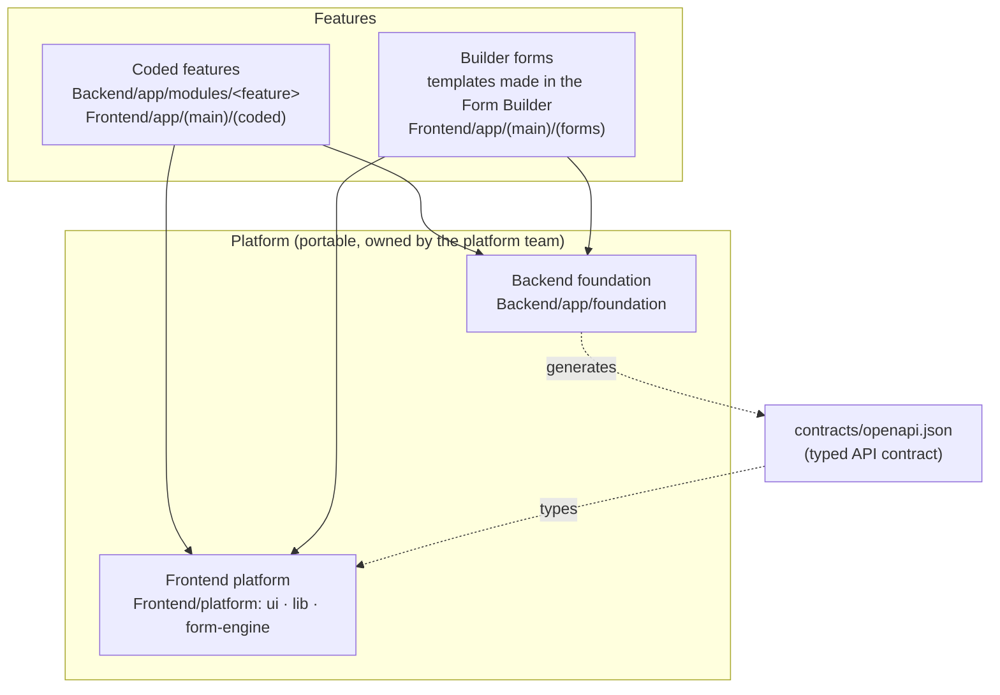

# Architecture: hybrid feature delivery on a portable platform

This repository follows **Option 3 (Hybrid: code complex + builder simple)** of the Teller Portal Architecture Strategy, built
so it can grow into Option 4 (contract-based feature platform) later — see [ADR 0001](adr/0001-hybrid-feature-delivery.md).
The tech is unchanged in kind (FastAPI + async SQLAlchemy, Next.js), modernized in version (Next.js 16, design system on
shadcn/ui + Radix + Tailwind 4, TanStack Query/Table/Form, Zod, OpenAPI-generated types) — [ADR 0003](adr/0003-ui-stack.md).

## The two delivery paths
| | Coded | Form |
|---|---|---|
| For | money, balances, lifecycles, integrations, server-trusted rules | data capture, field rules, conditional fields, attachments, one approval |
| Backend | `app/modules/<feature>/` (ModuleSpec + routers/services/schemas/models) | generic `form_builder` + `form_submission` modules |
| Frontend | `app/(main)/(coded)/<feature>/` on `@platform/ui` | rendered by the form engine; data viewer for the requests |
| Change | pull request, CI, deploy | builder → publish (→ approval when `forms.require_approval` is on) |
| Registry | `features/<id>/feature.yaml` (`type: coded`) | `features/<id>/feature.yaml` (`type: form`) |

How to classify: [`features/README.md`](../../features/README.md).

## Runtime flows
* **Coded**: user → Next.js page `(coded)/<feature>` → `@platform/lib/api/client` (token, refresh, Idempotency-Key) → module
  router (`secure_router`, `require(...)`, module flag) → service (`CrudService`, approval / numbering / idempotency) →
  database (tenant guard + RLS, audit in the same transaction).
* **Form**: user → `PublishedFormRenderer` → `GET /template/forms/templates/{id}/published` (the published version, never the
  builder's working copy) → `POST /form/submissions` (pinned to that version, idempotent) → data viewer
  (`/form/submissions/query`).

## Layers and rules (enforced)
* Backend: `app/foundation` never imports `app/modules` or `app/main` (`tests/test_architecture.py`); modules use the foundation
  only through its public modules; every module folder has a `ModuleSpec` and is listed in `INSTALLED_MODULES`.
* Frontend: `platform/form-engine → platform/ui → platform/lib`, never upward, never into `app/` (ESLint). Features import
  `@platform/ui` (never `radix-ui` directly; PrimeReact was removed), `@platform/form-engine`
  (public entry only), `@platform/lib/...`.
* The API contract (`contracts/openapi.json`) is regenerated with every API change and checked on both sides
  (`tests/test_openapi_contract.py`, `npm run api:check`).

## Where things are
| | |
|---|---|
| Platform capabilities (what exists, where, how to use) | [capability-catalog.md](capability-catalog.md) |
| UI migration (PrimeReact → design system, stages A–D, done) | [ui-migration.md](ui-migration.md) |
| Decisions | [adr/](adr/) |
| Progress of the restructure | [PROGRESS.md](PROGRESS.md) |
| Form builder: gaps to enterprise grade (17, in order) | [form-builder-gaps.md](form-builder-gaps.md) |
| Feature registry | [`features/`](../../features/README.md) |
| Backend platform details | [`Backend/README.md`](../../Backend/README.md), [`Backend/app/foundation/README.md`](../../Backend/app/foundation/README.md) |
| Frontend platform details | [`Frontend/platform/README.md`](../../Frontend/platform/README.md) |

## Towards Option 4
The pieces Option 4 needs already have their place: `feature.yaml` (contract), the module registry (capability resolver input),
`contracts/openapi.json` (API contract), permissions/approval policies/sequences declared in code (resolvable capabilities).
Next steps when the organization is ready: a JSON Schema for `feature.yaml`, a `feature validate` command in CI that checks
each file against the registry (module, permissions, policies, sequences exist), then scaffolding (`feature create`).
